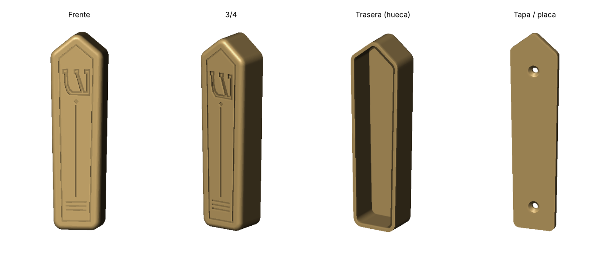

# Caja de Mezuzá paramétrica (ש)



Caja de mezuzá elegante para impresión 3D: silueta afinada con punta superior,
borde frontal redondeado, ranura de marco, línea central con rombo, líneas
inferiores y la letra **Shin (ש) grabada (metida)** — o en relieve, con un parámetro.

| Carpeta | Contenido |
|---|---|
| `onshape/MezuzaCase.fs` | **Custom Feature de Onshape** (FeatureScript), 100 % paramétrica |
| `python/mezuza.py` | Generador de STL con la misma geometría y parámetros |
| `python/render.py` | Render de la vista previa |
| `stl/` | STL listos: `mezuza_caja.stl` (Shin grabada), `mezuza_caja_relieve.stl`, `mezuza_tapa.stl` |
| `stl/mezuza_placa.3mf` | **Placa lista para el laminador**: caja + tapa ya orientadas y colocadas sobre la cama |

## Usar en Onshape

1. En tu documento: **+ → Create Feature Studio**, borra el contenido y pega `onshape/MezuzaCase.fs`.
   (Si Onshape propone otra versión en la primera línea `FeatureScript ####;` / `version : "####.0"`, puedes usar la suya.)
2. Pulsa **Commit**.
3. Ve a un **Part Studio** → icono de *Custom features* en la barra → **Caja de Mezuzá**.
4. Ajusta los parámetros; se crean dos piezas: **Mezuzá - Caja** y **Mezuzá - Tapa**.
5. Clic derecho en cada pieza → **Export** → STL.

## Parámetros principales (valores por defecto)

| Grupo | Parámetro | Defecto |
|---|---|---|
| Forma | Altura total / ancho inferior / ancho superior | 125 / 30 / 34 mm |
| | Altura de la punta (0 = tapa recta) | 9 mm |
| | Profundidad / radio de esquinas / redondeo frontal | 22 / 6 / 3 mm |
| Paredes | Pared / cara frontal | 2.2 / 2.8 mm |
| Shin | Estilo (Grabado / Relieve), altura, centro desde arriba, profundidad | Grabado, 17, 30, 1.4 mm |
| Decoración | Ranura de marco, margen, ancho, profundidad | sí, 2.5, 1.0, 0.8 mm |
| | Línea central + líneas inferiores, nº, separación | sí, 3, 2.6 mm |
| Tapa | Espesor, holgura, Ø tornillo, Ø cabeza | 3, 0.2, 3.5, 7 mm |

Espacio interior con los valores por defecto: ≈ 25 × 16 mm de sección y ≈ 120 mm de largo,
para un klaf de **10–11 cm**. Para klaf de 12 cm usa altura ≈ 135 mm; para 15 cm, ≈ 165 mm.

## Generar STL sin Onshape

```bash
pip install manifold3d trimesh numpy
python python/mezuza.py                                  # por defecto
python python/mezuza.py --length 135 --shin-mode relieve # variantes
python python/mezuza.py --help                           # todos los parámetros
```

## Impresión

- **Caja**: de pie (base plana sobre la cama) para que la Shin y las ranuras salgan nítidas
  en la pared vertical; o con la cara trasera abierta sobre la cama (puente de ~25 mm en el techo).
- Capa 0.12–0.16 mm, 3 perímetros, boquilla 0.4 mm. PLA/PETG; queda muy bien en PLA seda dorado.
- **Tapa**: plana, avellanado hacia arriba.
- Montaje: atornilla la tapa al marco de la puerta, coloca el klaf y encaja la caja a presión.
  Si queda floja, baja la holgura a 0.1 mm o añade una gota de silicona.
